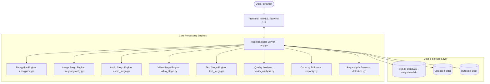

# StegoShieldAI: Advanced Multi-Modal Steganography, AI Steganalysis & Image Quality Evaluation Platform
## Comprehensive Technical Documentation

---

## 1. System Overview & Vision

**StegoShieldAI** is an end-to-end, enterprise-grade cybersecurity suite designed for high-security multi-modal steganography, steganalysis payload detection, and visual signal fidelity analysis.

The system empowers security researchers, digital forensics analysts, and privacy-conscious users to hide encrypted secret messages inside diverse media formats (Images, Audio, Video, and Text), evaluate stego signal distortion using standard perceptual quality metrics (PSNR, SSIM, MSE), detect hidden steganographic data through AI statistical steganalysis (Shannon Entropy, Chi-Square PoV), and manage encrypted credentials in an isolated local database vault.

### Key Capabilities
- **Multi-Modal Steganography**: Support for PNG/BMP images (LSB spatial domain), WAV audio (LSB sample domain), MP4/AVI videos (keyframe embedding), and UTF-8 text (Zero-Width Non-Joiner / Unicode steganography).
- **AES-256 Payload Encryption**: All embedded payloads undergo AES-256-CBC encryption derived via PBKDF2 HMAC SHA-256 key derivation with random 16-byte IVs and SHA-256 integrity checksums.
- **AI Statistical Steganalysis**: Bitplane Shannon Entropy scoring, Chi-Square Pair-of-Values (PoV) histogram analysis, and magic header scanning to identify stego artifacts in suspicious files.
- **Signal Distortion & Quality Analytics**: Automated computation of Peak Signal-to-Noise Ratio (PSNR), Structural Similarity Index (SSIM), Mean Squared Error (MSE), and generation of visual residual differential heatmaps.
- **Capacity Estimation**: Pre-flight calculations for theoretical payload capacity across media formats before encoding.
- **User Authentication & Encrypted Vault**: Multi-user authentication system backed by SQLite with PBKDF2 password hashing and an encrypted secret vault.

---

## 2. Architecture & System Flow



---

## 3. Detailed Module Specifications

### 3.1 `backend/encryption.py` (Cryptography & Encryption Engine)
The encryption engine ensures confidentiality and payload integrity prior to steganographic insertion.

#### Key Components:
- **`EncryptionEngine`**:
  - **`derive_key(passphrase: str, salt: bytes) -> bytes`**: Uses `PBKDF2HMAC` with `SHA256`, 100,000 iterations to derive a 32-byte (256-bit) symmetric key.
  - **`encrypt_payload(secret_text: str, passphrase: str) -> bytes`**:
    1. Generates 8-byte SHA-256 checksum of raw secret text for post-extraction verification.
    2. Prepends magic prefix `STEGO_SIG_v1:` and checksum to message.
    3. Pads message using PKCS7 (128-bit blocks).
    4. Encrypts payload with `AES-256-CBC` using a random 16-byte Initialization Vector (IV).
    5. Returns concatenated `salt + IV + ciphertext`.
  - **`decrypt_payload(encrypted_bytes: bytes, passphrase: str) -> str`**:
    1. Extracts 16-byte salt and 16-byte IV.
    2. Re-derives key using PBKDF2.
    3. Decrypts AES-256-CBC ciphertext and unpads PKCS7 padding.
    4. Validates `STEGO_SIG_v1:` header prefix and verifies SHA-256 checksum.

- **`VaultCipher`**:
  - Encrypts and decrypts secret notes stored in the database vault using Fernet (AES-128-CBC with HMAC-SHA256 authentication).

---

### 3.2 `backend/steganography.py` (Image Steganography Engine)
Performs Least Significant Bit (LSB) spatial domain embedding and extraction on RGB images.

#### Header Structure:
Every embedded stego file starts with a 64-bit binary header:
- **Bytes 0–3 (32 bits)**: Magic Header `STEG` (`0x53544547`).
- **Bytes 4–7 (32 bits)**: 32-bit unsigned integer representing total payload length in bytes.

#### Core Algorithms:
- **`embed_secret(image_path: str, secret_bytes: bytes, output_path: str) -> str`**:
  1. Opens cover image using Pillow (`PIL.Image`) and converts to RGB mode.
  2. Constructs binary header (`STEG` + 32-bit length integer) and appends secret payload bits.
  3. Iterates over flattened RGB pixel values and replaces LSB ($b_0 = P \pmod 2$) with payload bit.
  4. Saves output as lossless `.png` or `.bmp` to prevent compression loss.
- **`extract_secret(stego_image_path: str) -> bytes`**:
  1. Reads LSB bitstream from flattened RGB pixels.
  2. Extracts first 32 bits to verify magic header `STEG`.
  3. Extracts next 32 bits to read payload byte length $L$.
  4. Reads next $L \times 8$ bits, packs bits into byte array, and returns raw binary payload.

---

### 3.3 `backend/audio_stego.py` (Audio Steganography Engine)
Performs LSB steganography on uncompressed Pulse-Code Modulation (PCM) 16-bit audio WAV files.

#### Core Methods:
- **`embed_audio_secret(audio_path: str, secret_bytes: bytes, output_path: str)`**:
  - Reads 16-bit audio frame samples using Python's standard `wave` library.
  - Constructs header (`STEG` + 32-bit payload size).
  - Modifies LSB of each 16-bit integer audio sample (`sample = (sample & ~1) | bit`).
- **`extract_audio_secret(stego_audio_path: str) -> bytes`**:
  - Reads WAV audio sample stream.
  - Extracts 64-bit header to check signature and length.
  - Unpacks remaining embedded payload bits into original byte array.

---

### 3.4 `backend/video_stego.py` (Video Steganography Engine)
Hides secret payloads across sequential video frames in uncompressed/lossless video streams.

#### Operational Mechanism:
1. Decomposes video container into individual image frames using OpenCV (`cv2`).
2. Distributes encrypted payload bits across frame RGB channels using LSB spatial embedding.
3. Re-assembles modified frames back into container format (`.avi` / `.mp4`).

---

### 3.5 `backend/text_stego.py` (Text Steganography Engine)
Implements linguistic / invisible steganography inside cover plain text files using Unicode zero-width characters.

#### Zero-Width Character Mapping:
- Binary `0` $\rightarrow$ Zero-Width Non-Joiner (`U+200C` / `\u200c`)
- Binary `1` $\rightarrow$ Zero-Width Joiner (`U+200D` / `\u200d`)
- Separator $\rightarrow$ Zero-Width Space (`U+200B` / `\u200b`)

#### Advantage:
The resulting stego text file appears completely normal to human eyes and standard text viewers while carrying encrypted binary payloads.

---

### 3.6 `backend/detection.py` (AI & Statistical Steganalysis Engine)
Detects suspicious hidden data in images using mathematical, statistical, and structural signatures.

#### Key Metrics & Formulas:

1. **Shannon Entropy Analysis**:
   Measures randomness in bitplanes. Purely random noise has maximum entropy ($1.0$).
   $$\text{Entropy } H = - (p_0 \log_2 p_0 + p_1 \log_2 p_1)$$
   where $p_1$ is the proportion of 1-bits and $p_0 = 1 - p_1$ in the 0th bitplane.

2. **Chi-Square ($\chi^2$) Pair-of-Values (PoV) Analysis**:
   LSB steganography equalizes occurrences of adjacent pixel value pairs $(2k, 2k+1)$.
   $$\chi^2 = \sum_{k=0}^{127} \frac{(f_{2k} - f_{2k}^*)^2}{f_{2k}^*}, \quad f_{2k}^* = \frac{f_{2k} + f_{2k+1}}{2}$$
   A low $p$-value / high $\chi^2$ score indicates steganographic manipulation.

3. **Magic Header Detector**:
   Scans pixel LSB sequence for `STEG` header (`0x53544547`).

---

### 3.7 `backend/quality_analysis.py` (Signal Quality & Distortion Analyzer)
Evaluates visual degradation introduced by steganographic modification.

#### Mathematical Metrics:

1. **Mean Squared Error (MSE)**:
   $$\text{MSE} = \frac{1}{M \times N \times C} \sum_{i=1}^{M} \sum_{j=1}^{N} \sum_{k=1}^{C} \left( I_{\text{cover}}(i,j,k) - I_{\text{stego}}(i,j,k) \right)^2$$

2. **Peak Signal-to-Noise Ratio (PSNR)**:
   $$\text{PSNR} = 10 \cdot \log_{10} \left( \frac{\text{MAX}^2}{\text{MSE}} \right) = 10 \cdot \log_{10} \left( \frac{255^2}{\text{MSE}} \right) \quad (\text{in dB})$$
   - PSNR $> 45\text{ dB}$: High visual fidelity (imperceptible modification).
   - PSNR $< 35\text{ dB}$: Noticeable degradation.

3. **Structural Similarity Index (SSIM)**:
   $$\text{SSIM}(x,y) = \frac{(2\mu_x\mu_y + C_1)(2\sigma_{xy} + C_2)}{(\mu_x^2 + \mu_y^2 + C_1)(\sigma_x^2 + \sigma_y^2 + C_2)}$$

4. **Visual Residual Differential Heatmap**:
   Generates amplifiable differential image $(\text{Stego} - \text{Cover}) \times 20$ to highlight altered pixels.

---

### 3.8 `backend/capacity.py` (Theoretical & Payload Capacity Estimator)
Calculates maximum safe payload capacity based on carrier file dimensions and encoding technique.

- **Image Capacity**:
  $$\text{Capacity (bytes)} = \frac{\text{Width} \times \text{Height} \times \text{Channels}}{8} - \text{Header Overhead (8 bytes)}$$
- **Audio Capacity**:
  $$\text{Capacity (bytes)} = \frac{\text{Num Samples} \times \text{Channels}}{8} - \text{Header Overhead (8 bytes)}$$

---

### 3.9 `backend/database.py` (Database Engine & Schema)
Implements relational storage in SQLite (`backend/stegoshield.db`).

#### Database Schema:

```sql
-- Users Table
CREATE TABLE IF NOT EXISTS users (
    id INTEGER PRIMARY KEY AUTOINCREMENT,
    username TEXT UNIQUE NOT NULL,
    email TEXT UNIQUE NOT NULL,
    password_hash TEXT NOT NULL,
    created_at TIMESTAMP DEFAULT CURRENT_TIMESTAMP
);

-- Steganography Activity History Table
CREATE TABLE IF NOT EXISTS history (
    id INTEGER PRIMARY KEY AUTOINCREMENT,
    user_id INTEGER NOT NULL,
    action_type TEXT NOT NULL,          -- 'Encode' or 'Decode'
    filename TEXT NOT NULL,
    output_filename TEXT,
    payload_size INTEGER DEFAULT 0,
    stego_score REAL DEFAULT 0.0,
    status TEXT DEFAULT 'Success',
    timestamp TIMESTAMP DEFAULT CURRENT_TIMESTAMP,
    FOREIGN KEY (user_id) REFERENCES users (id)
);

-- Encrypted Secret Vault Table
CREATE TABLE IF NOT EXISTS vault (
    id INTEGER PRIMARY KEY AUTOINCREMENT,
    user_id INTEGER NOT NULL,
    title TEXT NOT NULL,
    note TEXT,                           -- Fernet Encrypted Ciphertext
    secret_key TEXT NOT NULL,
    timestamp TIMESTAMP DEFAULT CURRENT_TIMESTAMP,
    FOREIGN KEY (user_id) REFERENCES users (id)
);
```

---

## 4. REST API & Endpoint Reference

| Endpoint | Method | Purpose | Authentication |
| :--- | :--- | :--- | :--- |
| `/` | `GET` | Landing Page & Hero Overview | Public |
| `/login` | `GET`, `POST` | User Authentication | Public |
| `/register` | `GET`, `POST` | New Account Registration | Public |
| `/logout` | `GET` | Terminate Active User Session | Required |
| `/dashboard` | `GET` | Activity Statistics & System Overview | Required |
| `/encode` | `GET`, `POST` | Image Steganography Encoding Page | Required |
| `/decode` | `GET`, `POST` | Image Steganography Decoding Page | Required |
| `/audio_stego` | `GET`, `POST` | Audio Steganography Embed/Extract | Required |
| `/video_stego` | `GET`, `POST` | Video Steganography Embed/Extract | Required |
| `/text_stego` | `GET`, `POST` | Zero-Width Text Steganography Page | Required |
| `/quality_analysis` | `GET`, `POST` | Run PSNR, SSIM, MSE on Cover vs Stego | Required |
| `/capacity_checker` | `GET`, `POST` | Media Capacity Calculation Endpoint | Required |
| `/detection` | `GET`, `POST` | Steganalysis & Threat Score Scanner | Required |
| `/vault` | `GET`, `POST` | Encrypted Secret Vault Management | Required |

---

## 5. Security & Threat Model

1. **Authentication Security**: Passwords are hashed using PBKDF2-HMAC-SHA256 with random salt via `werkzeug.security`.
2. **Session Protection**: Flask secret key is dynamically generated and stored in `.secret_key` with strict permissions.
3. **Pluggable Carrier Formats**: Image outputs strictly use lossless PNG/BMP formats to avoid lossy compression corruption (e.g. JPEG artifacts).
4. **Zero Knowledge Payload Integrity**: Decryption verifies both a cryptographic magic signature (`STEGO_SIG_v1:`) and SHA-256 payload checksum before outputting plain text.

---

## 6. Installation & Execution Guide

### Prerequisites
- Python 3.10+ installed
- Virtual environment support (`venv`)

### Setup Instructions

1. **Clone & Navigate**:
   ```bash
   cd d:\Arya\StegoShieldAI
   ```

2. **Create & Activate Virtual Environment**:
   ```bash
   python -m venv venv
   # On Windows PowerShell:
   .\venv\Scripts\Activate.ps1
   # On Linux / macOS:
   source venv/bin/activate
   ```

3. **Install Required Packages**:
   ```bash
   pip install -r backend/requirements.txt
   ```

4. **Launch Application**:
   ```bash
   python backend/app.py
   ```

5. **Access Application**:
   Open browser and navigate to `http://127.0.0.1:5000`

---

## 7. Quality Assurance & Verification Tests

The backend includes a dedicated test suite (`backend/test_suite.py`) covering:
- Encryption & Decryption round-trips
- Image Steganography embedding & extraction accuracy
- Audio Steganography integrity
- Quality metric computations (PSNR, SSIM, MSE)
- Steganalysis detection accuracy

Run tests with:
```bash
python backend/test_suite.py
```
