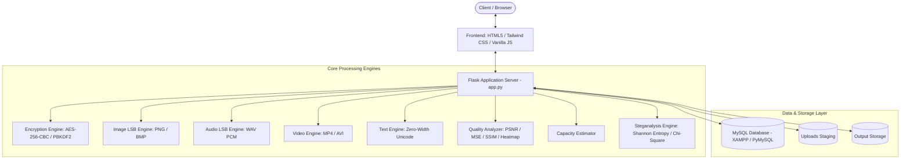

# 🛡️ StegoShield AI

> **Next-Generation Multi-Modal Steganography, Cryptographic Protection & AI Steganalysis Detection Platform**

[](https://python.org)
[](https://flask.palletsprojects.com/)
[](https://cryptography.io)

---

## 📌 Executive Summary

**StegoShield AI** is an enterprise-grade cybersecurity platform engineered for covert communication, digital forensics, and media steganography detection. It integrates **military-grade payload encryption (AES-256-CBC)** with **multi-modal steganographic embedding across Images, Audio, Video, and Plain Text**, coupled with an **AI-assisted statistical steganalysis engine** and a **signal quality evaluation pipeline** (PSNR, MSE, SSIM, and residual differential heatmaps).

---

## 🚀 Key Modules & Capabilities

### 1. 🖼️ Multi-Modal Steganography Engine

StegoShield provides concealment mechanisms tailored for each media format:

*   **Image Steganography (Spatial LSB)**:
    *   Hides encrypted payloads into the least significant bits of RGB pixel channels in lossless formats (**PNG, BMP**).
    *   Embeds a 64-bit binary header containing a magic signature (`STEG` / `0x53544547`) and a 32-bit payload byte count for deterministic extraction.
*   **Audio Steganography (PCM Sample LSB)**:
    *   Embeds data into uncompressed 16-bit **WAV** audio samples.
    *   Modifies audio bitstream samples imperceptibly without introducing audible acoustic distortion.
    *   Includes custom audio signature headers (`SSAU`).
*   **Video Steganography (Frame Container Embedding)**:
    *   Embeds payloads across non-header data zones of **MP4 / AVI** video containers.
    *   Employs sequential bit-level embedding protected by the `SSVI` signature.
*   **Text Steganography (Zero-Width Unicode)**:
    *   Conceals binary payloads invisibly inside ordinary plain text documents.
    *   Encodes bits using Zero-Width Non-Joiner (`U+200C` / binary `1`) and Zero-Width Space (`U+200B` / binary `0`), flanked by byte delimiters (`U+200D`) and byte-order-mark signatures (`U+FEFF`).
    *   Completely imperceptible to human readers, standard text editors, and word processors.

---

### 2. 🔐 Cryptographic Core & Key Management

Before any payload is embedded into carrier media, it passes through a multi-tier cryptographic pipeline:

*   **AES-256-CBC Symmetric Encryption**:
    *   Keys are derived dynamically from user passphrases using **PBKDF2-HMAC-SHA256** with **100,000 iterations** and a unique 16-byte cryptographically secure random salt.
    *   Each encryption session uses a fresh, random 16-byte Initialization Vector (IV).
    *   Standard PKCS#7 block padding ensures strict 128-bit block alignment.
*   **Integrity Verification**:
    *   A SHA-256 integrity checksum prefix (`STEGO_SIG_v1:`) is attached to payloads prior to encryption, verifying payload authenticity and preventing incorrect passphrase extraction attempts.
*   **Encrypted Personal Vault**:
    *   Authenticated users have access to an isolated vault powered by **Fernet authenticated cryptography (AES-128-CBC + HMAC-SHA256)** to store secret passphrases, tokens, and stego session keys safely in an SQLite backend.

---

### 3. 🔍 AI & Statistical Steganalysis (Detection Engine)

StegoShield includes a forensic detection module capable of analyzing suspicious carrier images for hidden steganographic tampering:

*   **Bitplane Shannon Entropy ($H$)**:
    *   Measures randomness in the 0th bitplane. Natural uncompressed images have low LSB entropy ($H \ll 1.0$), while encrypted steganographic data pushes entropy toward uniform randomness ($H \to 1.0$):
    $$H = -\sum_{i \in \{0, 1\}} p_i \log_2(p_i)$$
*   **Chi-Square ($\chi^2$) Pair-of-Values (PoV) Analysis**:
    *   Analyzes adjacent pixel value histograms $(2k, 2k+1)$. LSB substitution artificially equalizes adjacent frequencies; the engine detects this statistical flattening to identify modified carriers.
*   **Magic Header & Signature Scanner**:
    *   Directly inspects the initial bitstream for valid signatures and declared payload lengths.
*   **Threat Assessment Verdict**:
    *   Outputs a **Stego Confidence Score (0% – 100%)** categorized into `CLEAN`, `MODERATE ANOMALY`, `SUSPICIOUS`, or `CONFIRMED STEGO PAYLOAD`.

---

### 4. 📊 Signal Quality & Distortion Analytics

Quantifies visual degradation between original cover media and stego output:

| Metric | Target / Benchmark | Description |
| :--- | :--- | :--- |
| **PSNR** (Peak Signal-to-Noise Ratio) | **$> 45\text{ dB}$** (Excellent fidelity) | Measures signal fidelity in decibels: $\text{PSNR} = 10 \log_{10} \left( \frac{255^2}{\text{MSE}} \right)$ |
| **MSE** (Mean Squared Error) | **$\approx 0$** (Minimal distortion) | Average squared error across all RGB pixel coordinates |
| **SSIM** (Structural Similarity Index) | **$> 0.999$** (Virtually identical) | Measures perceptual preservation of luminance, contrast, and structure |
| **Differential Heatmap** | Visual Inspection | Generates an amplified residual difference image ($|\text{Stego} - \text{Cover}| \times 20$) highlighting altered pixels |

---

### 5. 🧮 Capacity Estimation Engine

*   Pre-flight capacity calculator for images, audio, video, and text before encoding.
*   Calculates maximum safe payload thresholds and provides instantaneous percentage utilization indicators to prevent carrier saturation.

---

## 🏛️ System Architecture



---

## 📂 Repository Structure

```text
StegoShieldAI/
├── backend/
│   ├── app.py                 # Flask server, route controllers & session security
│   ├── encryption.py           # AES-256-CBC, PBKDF2 key derivation & VaultCipher
│   ├── steganography.py        # Image LSB spatial domain embedding & extraction
│   ├── audio_stego.py          # WAV audio LSB embedding & extraction
│   ├── video_stego.py          # MP4/AVI video container embedding & extraction
│   ├── text_stego.py           # Zero-width Unicode text steganography
│   ├── detection.py            # AI Steganalysis (Shannon entropy & Chi-square PoV)
│   ├── quality_analysis.py     # Signal quality metrics (PSNR, MSE, SSIM, heatmaps)
│   ├── capacity.py             # Media payload capacity estimator
│   ├── database.py             # MySQL database layer, user auth & encrypted vault
│   ├── test_suite.py           # Comprehensive automated test suite
│   ├── requirements.txt        # Python backend dependencies
│   ├── uploads/                # Temporary uploaded files directory
│   └── output/                 # Generated stego artifacts & differential heatmaps
├── frontend/
│   ├── static/
│   │   └── style.css           # Global custom stylesheets & responsive design
│   └── templates/
│       ├── base.html           # Master navigation & base template
│       ├── index.html          # Landing page & feature showcase
│       ├── encode.html         # Universal multi-modal encoding portal
│       ├── decode.html         # Universal extraction & decryption portal
│       ├── image_stego.html    # Dedicated image steganography workspace
│       ├── audio_stego.html    # Dedicated audio steganography workspace
│       ├── video_stego.html    # Dedicated video steganography workspace
│       ├── text_stego.html     # Dedicated zero-width text steganography workspace
│       ├── quality_analysis.html# Perceptual quality analyzer & heatmap viewer
│       ├── capacity_checker.html# Pre-flight payload capacity calculation tool
│       ├── dashboard.html      # User workspace, audit logs & encrypted vault
│       ├── login.html          # Authentication login portal
│       └── register.html       # Member account registration portal
├── DOCUMENTATION.md            # In-depth technical specification and API documentation
└── README.md                   # Project overview & quickstart guide
```

---

## ⚙️ Installation & Quickstart

### Prerequisites

*   **Python 3.10+**
*   **MySQL Server** (e.g. via [XAMPP](https://www.apachefriends.org/) or standalone MySQL)
*   **Git**

### 1. Clone the Repository

```bash
git clone https://github.com/aryakhadapkar8-web/stegoshield-ai.git
cd stegoshield-ai
```

### 2. Set Up a Virtual Environment

```bash
# Windows (PowerShell)
python -m venv .venv
.venv\Scripts\Activate.ps1

# Linux / macOS
python3 -m venv .venv
source .venv/bin/activate
```

### 3. Install Dependencies

```bash
pip install -r backend/requirements.txt
```

### 4. Database Setup (MySQL)

Start MySQL (e.g., via the XAMPP Control Panel) and initialize the database schema:

```sql
CREATE DATABASE IF NOT EXISTS stegoshield;
USE stegoshield;

CREATE TABLE IF NOT EXISTS users (
    id INT AUTO_INCREMENT PRIMARY KEY,
    username VARCHAR(255) UNIQUE NOT NULL,
    email VARCHAR(255) UNIQUE NOT NULL,
    password_hash VARCHAR(255) NOT NULL,
    created_at TIMESTAMP DEFAULT CURRENT_TIMESTAMP
);

CREATE TABLE IF NOT EXISTS history (
    id INT AUTO_INCREMENT PRIMARY KEY,
    user_id INT NOT NULL,
    action_type VARCHAR(50) NOT NULL,
    filename VARCHAR(255) NOT NULL,
    output_filename VARCHAR(255),
    payload_size INT DEFAULT 0,
    stego_score FLOAT DEFAULT 0.0,
    status VARCHAR(50) DEFAULT 'Success',
    timestamp TIMESTAMP DEFAULT CURRENT_TIMESTAMP,
    FOREIGN KEY (user_id) REFERENCES users (id) ON DELETE CASCADE
);

CREATE TABLE IF NOT EXISTS vault (
    id INT AUTO_INCREMENT PRIMARY KEY,
    user_id INT NOT NULL,
    title VARCHAR(255) NOT NULL,
    note TEXT,
    secret_key TEXT NOT NULL,
    timestamp TIMESTAMP DEFAULT CURRENT_TIMESTAMP,
    FOREIGN KEY (user_id) REFERENCES users (id) ON DELETE CASCADE
);
```

> **Note**: Database connection parameters can be adjusted in [backend/database.py](file:///d:/Arya/StegoShieldAI/backend/database.py) (default user: `root`, password: `""`, host: `localhost`).

### 5. Run the Automated Verification Suite

Verify all encryption, embedding, extraction, steganalysis, and signal quality operations:

```bash
python backend/test_suite.py
```

### 6. Launch the Web Platform

```bash
python backend/app.py
```

Navigate to **`http://127.0.0.1:5000`** in your browser.

---

## 🧪 Automated Test Suite

StegoShield includes built-in verification across all core layers:

1.  **AES-256-CBC Cryptography**: Verified PBKDF2 derivation, random IV generation, and SHA-256 checksum integrity.
2.  **Image Steganography**: LSB spatial embedding, header signature scanning, and lossless recovery.
3.  **Audio Steganography**: 16-bit WAV PCM sample LSB embedding and extraction.
4.  **Text Steganography**: Zero-width Unicode (`\u200B`, `\u200C`, `\u200D`) invisible data hiding.
5.  **Signal Fidelity Metrics**: Automated calculation verifying $\text{PSNR} \ge 40.0\text{ dB}$, $\text{SSIM} > 0.999$, and MSE.
6.  **Database & Vault Security**: User registration, session authentication, and Fernet vault credential persistence.

Run the suite anytime using:
```bash
python backend/test_suite.py
```

---

## 🔒 Security Best Practices

*   **Lossless Formats**: Always use lossless containers (**PNG, BMP, WAV**) for LSB steganography to avoid data loss caused by lossy compression algorithms (such as JPEG quantization or MP3 sub-band filtering).
*   **Strong Passphrases**: Payload confidentiality relies on AES-256-CBC with PBKDF2. Always supply high-entropy passphrases.
*   **Isolated Storage**: Uploaded files and temporary outputs are protected via session tokens and user ownership checks to prevent unauthorized artifact retrieval.
---